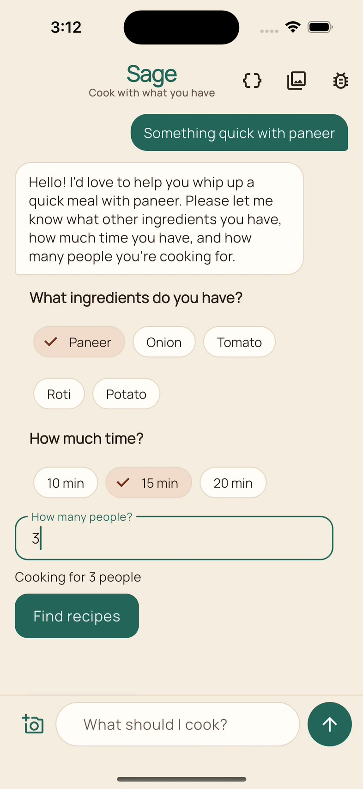
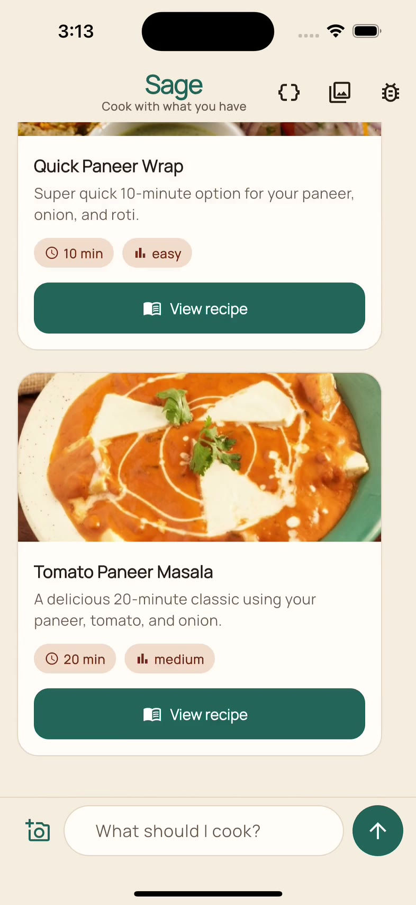
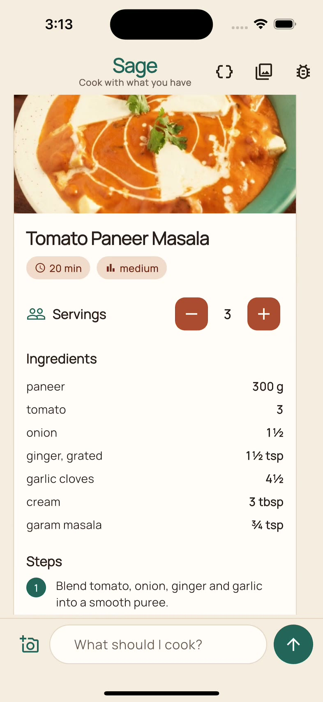
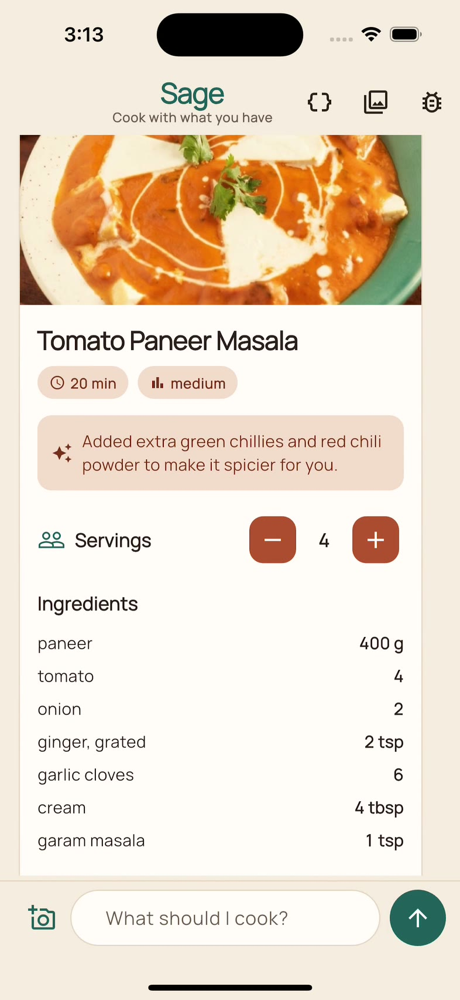

# 🌿 Sage — a Generative UI cooking assistant

> *Cook with what you have.*

Sage is a small Flutter app that demonstrates **Generative UI (GenUI)**: instead of replying with a wall of text, the AI **assembles a real, interactive screen** out of the app's own widgets — preference chips, recipe cards, a full recipe you can tweak — shaped by what you actually asked for.

Tell it *"something quick with paneer"* and it builds the UI: chips to confirm what's on hand and how many people you're cooking for, a few recipe cards to choose from, and a full recipe you can rescale on the device and adapt in place (*"no blender"* → it rewrites the steps).

Built with the experimental [**Flutter GenUI SDK**](https://docs.flutter.dev/ai/genui) (`genui` 0.10), the open [**A2UI**](https://a2ui.org/) (Agent‑to‑User Interface) protocol v0.9, and **Gemini** via Firebase AI Logic.

> 📊 **Talk slides:** this app is the live demo for the conference talk *"Building Generative Interfaces with Flutter's GenUI SDK"* — [**view the deck ↗**](https://akanshajain.dev/talks/genui/)

---

## 🎬 Demo

| Gather | Suggest | Cook | Adapt |
|:---:|:---:|:---:|:---:|
|  |  |  |  |

> *The full loop: "something quick with paneer" → preference chips → recipe cards → the full recipe → an in‑place "make it spicier" rewrite.*

---

## ✨ The core idea: the app owns the facts, the model owns the words

This is the principle the whole app is built around:

- **Facts** — recipe titles, cook times, ingredient amounts and default steps — live in a fixed local dataset ([`lib/data/recipes.dart`](lib/data/recipes.dart)). The model can **never invent** these, and scaling amounts is arithmetic the app does itself.
- **Words** — the friendly one‑line *reason* on a card, and an *adapted* set of steps + a note when you ask for a change — are the only things the model writes freely.

The model only ever references a recipe **by its `id`**. It proposes; your data disposes.

---

## 🔁 How it works

1. **Gather** — you ask for something; the model builds chips for ingredients and time, and a *"How many people?"* field. *It does not list recipes yet.*
2. **Suggest** — once it knows enough, it shows 2–3 **`RecipeCard`s**, each carrying only a `recipeId` + a friendly `reason`.
3. **Cook** — tap a card → the model renders the full **`RecipeView`**, with its servings **bound** to the surface data model.
4. **Scale** — change servings with the stepper → amounts rescale **on the device**. No model call.
5. **Adapt** — tap *No blender*, *Make it spicier* or *Fewer steps* → it re‑renders the **same** recipe with adapted steps and a note.

Every reply is a fresh **surface**, so earlier screens stay in the transcript.

### What happens on the device (no model call)

| Feature | How | A2UI concept |
|---|---|---|
| *"Cooking for 3 people"* updates as you type | the model writes `{"call": "formatString", …}` with `pluralize`; the device evaluates it | built‑in **client functions** |
| Submit stays disabled until the number is 1–12 | `checks` with `required` + `numeric` on the field and the button | client‑side **validation** |
| Servings stepper rescales the ingredients | `RecipeView.servings` is `{"path": "/servings"}`; the stepper writes the data model | two‑way **data binding** |

### Self‑healing

A2UI is an adjacency list: a `Column` names its children by id, and the model must send a component for each. When it forgets one, Sage **doesn't render the broken surface** — it sends the model a precise error naming the missing ids, shows *"asking it to rebuild…"*, and reveals the rebuilt surface (*"Rebuilt"*). Surfaces are only shown once the model's turn is complete, so half‑streamed UI never flashes on screen. In debug builds, the 🐞 button **breaks the next reply on purpose** to demo this on demand.

### Design

Sage uses its own design system, **"Masala Chai"**: deep teal for actions, terracotta for highlights, chai beige ground, [Manrope](https://fonts.google.com/specimen/Manrope) throughout, light and dark mode. Every text/background pair is AA-checked (4.5:1) by a test. The tokens live in one place ([`app/theme.dart`](lib/app/theme.dart)) and are mapped onto Material's theme, which is also what genui's built-in components read — so the chips, fields and buttons **the model chooses** are drawn in **our** design system. Screens fade in once, servings changes animate, and motion is skipped when the OS asks for reduced motion. The welcome screen offers starter prompts so a demo starts with one tap.

### See the protocol

The **`{ }`** button in the app bar shows the raw A2UI JSON behind every surface, and every action sent back — the model sends **data, not code**, which any A2UI renderer (Flutter, React, Angular, Lit…) could draw.

---

## 🏗 Architecture

```text
 UI (lib/ui)                 Session (lib/chat)                Agent (lib/agent)
 ───────────                 ──────────────────                ─────────────────
 SageHomePage ──listens──▶   SageSession (ChangeNotifier)      GeminiTransport
   TranscriptTile              ├─ Conversation ─────────────▶   (Firebase AI Logic,
   Composer, ProtocolPeek      ├─ SurfaceController             App Check)
                               ├─ turn gating + repair loop          ▲
                               └─ transcript entries          ObservedTransport ─▶ GlitchInjector
                                                               (protocol log, busy)  (demo tool)
 Catalog (lib/catalog): RecipeCard, RecipeView, prompts — Data (lib/data): recipes
```

- **`SageSession`** owns the genui loop and turns protocol traffic into immutable transcript entries. It has no UI and takes its model connection as a `Transport`, so it is tested with a fake model.
- **`GeminiTransport`** is the only file that knows about Gemini. genui is backend‑agnostic; swapping providers means replacing this one class.
- **Transport decorators** observe the wire without touching the model: `ObservedTransport` records the A2UI behind each surface and tracks in‑flight requests; `GlitchInjector` breaks a reply for the self‑healing demo.

---

## 🧩 The custom catalog

The app starts from genui's basic catalog (Text, Column, ChoicePicker, TextField, Button… plus its client functions), **removes** image/video/audio so the model can't render media it would have to invent, and **adds**:

- **`RecipeCard`** ([`catalog/recipe_card.dart`](lib/catalog/recipe_card.dart)) — `recipeId` (required) + `reason`.
- **`RecipeView`** ([`catalog/recipe_view.dart`](lib/catalog/recipe_view.dart)) — `recipeId` (required) + `servings` (binding) + optional adapted `steps` + `note`.

Both resolve their props through genui's `Bound*` widgets, so a value sent as a literal **or** a data binding works, and an unexpected type falls back to our own data instead of crashing.

Domain steering lives in [`catalog/recipe_prompts.dart`](lib/catalog/recipe_prompts.dart). Registering a widget makes it *possible* for the model to use; the prompt makes it *likely*. The exact JSON the prompt teaches (the servings checks and caption) is rendered through genui in the tests, so a typo there fails a test, not a demo.

---

## 📁 Project structure

```text
lib/
├── main.dart                     # Bootstrap + composition root (Firebase, App Check, session)
├── app/
│   ├── sage_app.dart             # MaterialApp
│   ├── theme.dart                # Brand tokens + ThemeData
│   └── app_check.dart            # Firebase App Check (required by AI Logic)
├── agent/
│   ├── gemini_transport.dart     # The seam to Gemini via Firebase AI Logic
│   ├── transport_decorators.dart # ObservedTransport (protocol log, busy), GlitchInjector
│   └── surface_check.dart        # Finds components a surface references but never got
├── catalog/
│   ├── recipe_catalog.dart       # The catalog + the system instruction
│   ├── recipe_prompts.dart       # Steering prompts
│   ├── recipe_card.dart          # RecipeCard: schema + widget
│   ├── recipe_view.dart          # RecipeView: schema + widget + servings binding
│   └── widgets/                  # Shared recipe widgets (image, pills, lookup, selection)
├── chat/
│   ├── sage_session.dart         # The conversation: genui loop, turn gating, repairs
│   ├── transcript.dart           # Immutable transcript entries
│   ├── ui_submissions.dart       # Parses actions/errors sent back to the model
│   └── error_messages.dart       # Friendly error text
├── data/
│   ├── recipe.dart               # Recipe / Ingredient models, scaling
│   ├── recipes.dart              # The trusted recipe dataset
│   └── photo_credits.dart        # Source, author and licence of every photo
└── ui/
    ├── home_page.dart            # Chat screen
    └── widgets/                  # Bubbles, composer, notices, protocol peek, credits, motion
assets/
├── images/recipes/               # One bundled photo per recipe (960×640)
└── google_fonts/                 # Manrope, bundled (SIL OFL)
test/                             # Mirrors lib/; offline, with a scripted fake model
integration_test/                 # Live end-to-end runs against Gemini
```

---

## 🚀 Getting started

### Prerequisites

- Flutter SDK (Dart `^3.10.9`)
- A **Firebase project** with **Firebase AI Logic** (Gemini API) enabled
- The [FlutterFire CLI](https://firebase.google.com/docs/flutter/setup)

### Setup

```bash
git clone https://github.com/jakansha2001/recipe_genui.git
cd recipe_genui
flutter pub get
flutterfire configure   # connect YOUR Firebase project (generates lib/firebase_options.dart)
flutter run
```

> ℹ️ The Firebase config files (`firebase_options.dart`, `android/app/google-services.json`, `ios/Runner/GoogleService-Info.plist`) are **gitignored**. Run `flutterfire configure` with your own project first.

### Firebase App Check (required)

Firebase AI Logic rejects requests without [App Check](https://firebase.google.com/docs/ai-logic/app-check). Once:

1. Enable the **Firebase App Check API** for your project.
2. Firebase Console → **Security → App Check → APIs** → *Firebase AI Logic* → **Enforce**.
3. Run the app in debug. On first launch each device/simulator logs an *App Check debug token*; add it under **App Check → Apps → ⋮ → Manage debug tokens**. It persists until the app is uninstalled.

Never commit a debug token. For CI, or tests that reinstall the app, pass a registered token from a secret store: `--dart-define=APP_CHECK_DEBUG_TOKEN=...`. Release builds use App Attest / Play Integrity / reCAPTCHA Enterprise instead.

The model is set in [`gemini_transport.dart`](lib/agent/gemini_transport.dart) (`gemini-3.1-flash-lite` by default). Every turn sends the full system instruction (~16k tokens), so the Gemini free tier's per‑minute input limit can be reached during quick rehearsals.

---

## 🧪 Testing

```bash
flutter analyze          # strict lints, see analysis_options.yaml
flutter test             # offline: a scripted fake model drives the real genui stack

# Live, against Gemini (reinstalls the app — use a spare simulator):
flutter test integration_test/live_flow_test.dart -d <device-id> \
  --dart-define=APP_CHECK_DEBUG_TOKEN=<registered token>
```

---

## 🛠 Tech stack

- **[genui](https://pub.dev/packages/genui)** `^0.10.4` + **[a2ui_core](https://pub.dev/packages/a2ui_core)** — the Flutter Generative UI SDK and the A2UI runtime it builds on
- **[firebase_ai](https://pub.dev/packages/firebase_ai)** `5.0.0` + **firebase_core** + **firebase_app_check** — Gemini via Firebase AI Logic (pinned: 5.1.0 needs Firebase iOS pods not yet on CocoaPods)
- **[json_schema_builder](https://pub.dev/packages/json_schema_builder)** — each widget's data schema
- **[image_picker](https://pub.dev/packages/image_picker)** — attach a fridge photo
- **[google_fonts](https://pub.dev/packages/google_fonts)** — Manrope, bundled in `assets/google_fonts` (no runtime fetching)
- **[url_launcher](https://pub.dev/packages/url_launcher)** — opens photo sources from the credits sheet

### Photos

Recipe photos are bundled, so the demo never depends on an image service. They come from [Unsplash](https://unsplash.com/license) and [Pexels](https://www.pexels.com/license/) (free to use) and [Wikimedia Commons](https://commons.wikimedia.org/) (CC BY-SA 2.0/4.0, which requires credit; our resized copies are shared under the same licence). Every photo is credited in the app (the 🖼 button) and in [`photo_credits.dart`](lib/data/photo_credits.dart).

---

## ⚠️ A note on stability

`genui` is **highly experimental**, and the Flutter team has announced it is being redesigned as modular packages — [`a2ui_core`](https://pub.dev/packages/a2ui_core), `a2ui_agent` and `a2ui_flutter` — with a different API. Pin your versions and expect to refactor when upgrading.

---

## 📚 Learn more

- [Flutter GenUI SDK docs](https://docs.flutter.dev/ai/genui) · [Get started](https://docs.flutter.dev/ai/genui/get-started)
- [New updates to A2UI and Flutter's GenUI package](https://flutter.dev/blog/new-updates-to-a2ui-and-flutters-genui-package) (Flutter blog)
- [A2UI — the protocol](https://a2ui.org/) · [A2UI v0.9 announcement](https://developers.googleblog.com/a2ui-v0-9-generative-ui/) · [a2ui-project/a2ui on GitHub](https://github.com/a2ui-project/a2ui)
- [flutter/genui on GitHub](https://github.com/flutter/genui) · [Getting started with GenUI (video)](https://www.youtube.com/watch?v=nWr6eZKM6no)
- [📊 Talk slides](https://akanshajain.dev/talks/genui/)

---

## 👤 Author

**Akansha Jain** — Senior Software Engineer · Organiser, Flutter Delhi & FFDG New Delhi
🌐 [akanshajain.dev](https://akanshajain.dev) · 💻 [github.com/jakansha2001](https://github.com/jakansha2001)

---

*Built to show that the best AI feature isn't another chat box — it's the screen you didn't have to design.*
